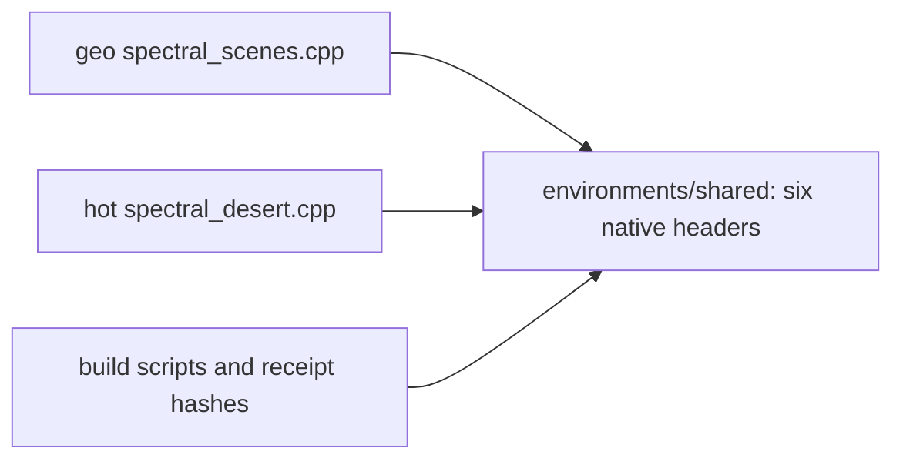
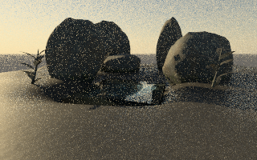
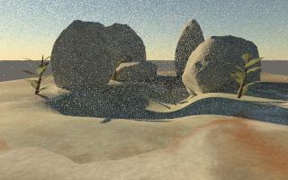

# Shared native headers: bounded extraction proof

The geo and hot renderers now compile six identical header implementations from `environments/shared`. Both previous engine-local copies were removed. The mathematical implementation bytes are unchanged; the move removes 428 duplicate physical lines (22,242 bytes). This is a duplication measure, not the whole-repository net line delta, which also includes build, test and proof additions.



The [move manifest](../../environments/provenance/shared-native-header-move.json) records original Git blobs and SHA-256 hashes. Compiler dependency output confirms both actual entrypoints consume the shared files. Historical `provenance/native-before` overlays remain historical inputs; Geode/Observatory epsilon and opacity policies remain separate.

## Executed native comparison

| New diagnostic scene | Actual native output |
| --- | --- |
| GEO: authored ground/minerals/leaves plus existing coast-wave water enclosure, 33,572 triangles |  |
| Hot: authored ground/minerals/leaves and native atmosphere, 22,468 triangles |  |

These are noisy **320 × 200, 16-sample diagnostic images**, not final-quality work or reproductions of the six existing environments. Both are real native renders, with no image generation. PNG encoding preserves the renderer PPM pixels.

MSVC 19.44.35215.0, C++17, `/O2 /openmp:llvm /arch:AVX2 /fp:precise`, one render thread, fixed seed 20261023, depth 12, indirect clamp zero. Identical geometry, atlas, grain and relief hashes were used before and after extraction. All 11 output buffers match byte for byte: linear PFM, display PPM, sixteen-band spectral film, geometry guides, sample counts, plus GEO support data. Both renderers report zero nonfinite path samples. Metadata also matches after removing elapsed time. See [parity](parity.json), [before receipt](before-capture.json), and [after receipt](after-capture.json). Timing differences are not a performance claim.

Four actual native entrypoints compile locally on Windows: geo, hot, Geode and Obsidian. Geode changes are limited to portable trailing-zero counting. Its geometry epsilon and transparent-material mask are unchanged. The existing Linux execution supervisor still uses `fcntl` and `/proc`; this CMake build does not establish portability of that supervisor or ARM acceleration.

## Baseline tests and limits

The pre-extraction Windows component baseline passes 20 of 22 checks, plus four Python source-resolution/cache tests. Both historical `test_spectral_desert_v5` checks fail; the geo-side one includes the bundled desert renderer, not the active three-scene renderer. The legacy test caps color at 0.88001 while the actual material implementation permits 0.91. Its reported 17.4 mm residual is also under separate compiler diagnosis: same-input scalar/noinline evaluation is within 0.01 mm. No tolerance was weakened for this extraction. Correcting those contracts/compiler behavior is a separate change; do not infer overall renderer qualification from extraction parity.

The six original full environment rerenders remain pending. Their historical geometry counts are 8,108,728 (Sandstone), 11,644,696 (Basalt), 20,400,257 (Fernwater input; historical loader rejects 180 near-degenerate triangles), 23,690,858 (Hot Springs), 6,210,833 (Obsidian), and 3,655,632 (Geode). Existing source generators and retained inputs must be used without geometry reduction. These small diagnostic scenes do not satisfy that coverage.

## Reproduce the bounded comparison

Use a C++17 compiler with OpenMP and the repository Python dependencies. On Windows use an x64 Visual Studio developer terminal with its OpenMP LLVM runtime on the process PATH. The native targets currently require x86-64/AVX2; no ARM execution is claimed here.

```text
cmake -S environments -B build/native -DCMAKE_BUILD_TYPE=Release
cmake --build build/native --config Release --parallel 1
ctest --test-dir build/native -C Release --output-on-failure
python -m unittest discover -s environments/tests -p test_native_sources.py -v
python environments/examples/shared_core_scene.py --out outputs/shared-native-core/new-scene
python environments/tools/native_parity.py after --build build/native
```

For a multi-configuration generator, pass the directory containing the executable (for example `build/native/Release`) to `--build`. Capture `before` using the pre-extraction portable baseline, retain its source/compiler/input receipt, then run `python environments/tools/native_parity.py compare`. Merely copying an after film into the before directory is not a valid comparison. This repository retains the original source reference and exact hashes; generated binaries and raw films stay outside Git.
