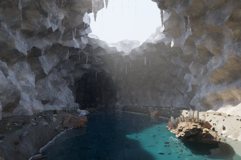

# Shared native scene headers

The geo and hot renderers now compile six identical implementations from `environments/shared`. Both engine-local copies were removed. The bodies remain byte-for-byte unchanged: six shared headers replace twelve active copies, removing 428 duplicate physical lines and 22,242 bytes. This is duplicate reduction, not the net repository line delta.

The [move manifest](../../environments/provenance/shared-native-header-move.json) records original Git blobs and SHA-256 hashes. Compiler dependencies confirm both actual entrypoints consume the shared files. Historical source overlays are retained. Geode/Observatory epsilon and opacity policies remain separate.

## Executed verification

All four actual native entrypoints compile on Windows x64: geo, hot, Geode and Obsidian. Current implementation at `7786190aa72cfcf21f3b248757a7598f5edd7759` passes all 28 native numerical/geometry/checkpoint tests, four Python source-resolution/cache tests and seven process-guard tests. See [current test results](windows-publication-tests.json) and the [earlier compiler-correction results](windows-native-tests.json). The compiler is MSVC 19.44.35215.0, with C++17, `/O2 /openmp:llvm /arch:AVX2 /fp:precise` and assertions enabled.

The original baseline failed both historical desert regression checks. Three refraction functions now take immutable vector references to avoid reproduced MSVC optimized by-value argument corruption. Their equation bodies are unchanged. The tests use the actual V11 material cap of 0.91 with the existing 0.00001 allowance. The water residual limit remains 0.000201 metres; no optical threshold was relaxed.

Extraction commit `b024110d210fa0e4e80789762bfac41a0c1cc9b8` was compared using 11 native buffers with exact byte agreement. The temporary synthetic fixture, generator, capture harness and previews were subsequently removed at the user's request. They are not active examples or proof that the six original environments were rerendered. Git history remains recoverable. That earlier image-parity result does not cover the later compiler correction.

The `Shared native scene core` workflow builds the actual renderers and runs numerical/geometry tests on Windows x64, Linux x64 and Intel macOS. Hosted results are pending publication. Current native targets require x86-64/AVX2; ARM support is not established. The older execution supervisor still depends on Linux `fcntl` and `/proc`.

## Original environments

The unchanged original Geode generator completed with 3,655,632 triangles, 228 parts and all five original 2048-square texture packs. The existing R2 enhancement preserves water records, material IDs, UVs and primitive order. Generated mesh hashes differ from archived Linux receipts; exact historical geometry byte identity has not been established.

The 1536 x 1024, 64-sample, depth-24 Geode render loaded every triangle and passed 5,000 BVH equivalence rays. A host-memory guard stopped it before a completed frame. The same-quality rerender awaits sufficient memory. No smaller geometry or substitute image is counted as complete.

### Bounded film storage

Geode now uses the shared `native_film_output.hpp` fixed-row writer. Its three 16-band films, three guide arrays and sample counts occupy 16 rows instead of the full image. At 1536 x 1024, those arrays decrease from 478,150,656 to 7,471,104 bytes; RGB conversion adds three small rows and one preview row. Geometry, textures, pixel seeds, sample counts, ray equations and per-pixel accumulation are unchanged. Band means retain their original global pixel order. PFM rows remain bottom-up; guides, counts and spectral records remain top-down.

The Windows build, binary row-layout/error checks and Geode optical self-test pass. The preserved old binary and new binary rendered the complete original geometry at matching 480 x 320, 16-sample, depth-24 settings. All nine native outputs (including 16-band spectral data, three PFM radiance/AOVs, three guide arrays, counts and PPM) and five finished/unfiltered PNGs agree byte for byte. Metadata, including band means, agrees except elapsed seconds. Both renders report zero invalid path samples. See the [exact hashes and source binding](geode-row-storage-parity.json).

Sampled peak working set decreased from 1,906,999,296 to 1,863,573,504 bytes at the comparison resolution. The full 1536 x 1024, 64-sample delivery remains pending; that larger image is not implied by this regression check. Original binaries and failed-attempt logs are retained. Geode is the first consumer of this output helper; other native renderers have not adopted it.



This is the actual bounded storage comparison at `e1c6b5b`, with all 3,655,632
original triangles. It does not show a completed full-resolution rerender or
verify the later interrupted/resumed image path.

All six original environment rerenders remain pending. Historical triangle counts are Sandstone 8,108,728; Basalt 11,644,696; Fernwater 20,400,257 input (180 near-degenerate triangles rejected by the historical loader); Hot Springs 23,690,858; Obsidian 6,210,833; Geode 3,655,632.

### Exact row checkpoints (image parity pending)

The Windows native checkpoint, row-output and Geode optics checks pass, as do
ten streaming/padding hash comparisons against Python hashlib. Independent
source review found no remaining blocker for the bounded image comparison.
The 480 x 320 uninterrupted reference completed, but host memory prevented the
next resumed phase from launching. See the [validation receipt](geode-resume-validation.json).

The verification runner retains its original 3 GiB preflight, 805,306,368-byte
host floor and 2,500,000,000-byte direct-process RSS cap. Explicit process-tree
mode records PID plus creation time, sums owned descendants and cleans up only
recorded identities. Seven small-process tests cover successful children,
memory/timeout stops, early parent exit, supervisor errors, preflight refusal,
and existing-receipt preservation. This supervisor is not a security sandbox.

The shared `native_checkpoint.hpp` utility is consumed by Geode. It checkpoints
only complete 16-row tiles (and the final shorter tile), after flushing all nine
native outputs. An immutable receipt binds the executable, the native/header
source closure and build policy, mesh, atlas, five texture packs, every render
setting, output headers/layouts, and SHA-256 hashes of all committed byte ranges.
PFM data is checked at its bottom-up tail; other data is checked at its top-down
prefix. Band means are saved as raw float bytes, together with the nonfinite
sample count and elapsed time. Resume retains global pixel seeds and accumulation
order. It exposes no caller-supplied next-row option.

The native executable checks the complete receipt chain and committed bytes
before loading geometry or opening output writers. A corrupt latest receipt,
missing committed boundary, changed input/config/source/binary, or truncated
committed range is an error; it does not silently fall back to older state.
Uncommitted tail bytes and abandoned `.pending-*` staging directories are never
treated as completion. Those tail rows are calculated again from the last
validated boundary. A new receipt is published by renaming an exclusively
created staging directory to a new boundary name, never by replacing a receipt.
This supports process interruption, not guaranteed power-loss durability;
post-crash validation rejects any damaged committed bytes.

Example, after generating the original inputs and compiling the native target:

```text
geode_r2 /absolute/scene.meshbin /absolute/new-run/hero --w 1536 --h 1024 --spp 64 --depth 24 --threads 4 --seed 735041 --exposure 1.4 --source-root /absolute/scenes-checkout --checkpoint-dir /absolute/new-run/checkpoints
```

Use an absolute executable path and set `CYBR_SURFACE_ATLAS` to the original
atlas. The output parent must exist; the checkpoint directory and outputs must
be new. Resume with the identical command plus `--resume`. The optional
`--stop-after-checkpoint N` exits with code 75 at a complete boundary for
interruption tests; it does not produce final metadata or certify completion.
Only one process may own a render's output directory at a time. Continue to use
the existing resource supervisor and unchanged memory limits.

Old partial renders made before checkpoint support have no valid receipt or
exact band-mean state and cannot be resumed. They remain incomplete. Hashing
uses the unchanged, pinned MIT-licensed [PicoSHA2](../../environments/shared/third_party/picosha2/PROVENANCE.md)
dependency; no new cryptographic algorithm or platform crypto library is added.
Original-scene interrupted/resumed image parity and current-platform build
results must be recorded before this path is used for final delivery.

## Run the tests

Use a C++17 compiler with OpenMP and the repository Python dependencies. On Windows use an x64 Visual Studio developer terminal with its OpenMP LLVM runtime on the process PATH.

```text
cmake -S environments -B build/native -DCMAKE_BUILD_TYPE=Release
cmake --build build/native --config Release --parallel 1
ctest --test-dir build/native -C Release --output-on-failure
python -m unittest discover -s environments/tests -p test_native_sources.py -v
python -m unittest discover -s environments/tests -p test_verification_guard.py -v
```

These tests exercise existing water/optics, spectral, material, acceleration, foliage and source-resolution contracts. They are not a completed six-scene image comparison or an engineering qualification.
