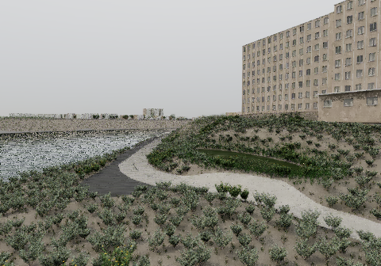
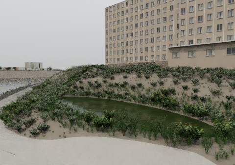

# Isla Vista: source-bound lagoon restoration

This is the original CYBR Isla Vista scene's coordinated San Nicolas bank
checkpoint. Both images below are actual native CYBR LIGHT CPU renders. They
are corrected-light procedural intermediates, not a photoreal completion claim.





## What this includes

- The complete mapped 128,606.96 m² UCSB Lagoon, broad Isla Vista terrain and
  mapped campus building context, and source-root trees within the documented
  view/detail region. This bounded lagoon assembly is not a claim that all
  residential streets have received the same new detail.
- One shared terrain TIN, exact material-boundary clipping, interpolated support
  and normals, and an explicit priority between overlapping paths and paving.
  Maximum recorded serialized support error is below one micrometre.
- A photo/history-informed small freshwater restoration basin, branched shrubs,
  species-differentiated foliage, wetland fringe, underlying mineral contacts,
  real window voids, glass, frames and curtains. Missing dimensions, planting
  state and optical values are explicit estimates.
- Two corrected-light native views. The old environment's longitude mismatch
  and erroneous reflectance-white factor on illuminant radiance are corrected.
  The native horizontal gray-card result agrees with integrated irradiance
  within 0.022% per channel, without an output color grade.

## Reproduce from public inputs

No private file IDs or historical source archive is required. Use Linux,
Python 3.12, a C++17/OpenMP compiler, `flock`, `taskset`, and at least 8 GiB disk
space for regenerated geometry and outputs. Install `requirements.txt` in a
virtual environment. Install the separate pinned CYBR LIGHT revision described
in `LIGHT_DEPENDENCY.json` with its portable extra. The entrypoint verifies its
namespaced `cybrlight.scene_compat` source manifest before execution; it does
not substitute for or replace the current public LIGHT engine.

```
python -m pip install -r requirements.txt
# Install CYBR LIGHT at LIGHT_DEPENDENCY.json's exact commit with [portable].
python public_inputs.py fetch
./run.sh verify
./run.sh materials
./run.sh build
./run.sh daylight-fixture
./run.sh capture --width 480 --spp 32 --view basin
./run.sh capture --width 480 --spp 16 --view lagoon-context
```

Run larger captures only after the small gate passes. Each `run.sh` phase holds
one shared landscape lock, uses two CPU threads, checks an owned-process-tree
4480 MiB sampled RSS cap, a 900-second deadline and a 1 GiB disk reserve. This
is a sampled user-space guard, not a kernel hard memory limit. Set
`CYBR_HEAVY_LOCK` to the same lock as other CYBR landscape work and `CYBR_CPUS`
if CPU0/1 are unavailable. No GPU, external image generator or Blender render
of these views is used.

The first `fetch` retrieves original recipes from CYBR MATERIAL commit
12848c82f60bc58fa88640545868009b90298b32 and the public UCSB GIS endpoints. It
verifies original raw hashes, or for JSON, every ordered feature, all attributes,
all coordinates and the consumed CRS. ArcGIS can alternate unconsumed
Integer/OID field-schema metadata; that alone does not change scene input.
Any meaningful feature drift fails rather than silently updating the scene.
These mutable query URLs are not durable dated archives. The public service
contract was checked successfully on 2026-10-12. If a provider changes the data,
a compatible dated public snapshot will be needed for exact reproduction.

USGS height rasters and editable OSM-derived habitat are bundled under their
respective terms. Raw UCSB pages and reference photograph/PDF pixels are not
redistributed. See `THIRD_PARTY_NOTICES.md`, `INPUTS.json`, and the source links.

## Evidence and visible limits

The basin view has 16,606,771 triangles, 32 packets × 6 spectral wavelengths
per pixel, zero invalid path samples, and a 3446.41 MiB sampled peak. The wider
16-packet gate peaked at 3504.05 MiB. Raw floating-point radiance, original
unfiltered display, native receipts, support and illuminant checks are retained.

The picture still has repetitive architectural openings, sparse coarse distant
habitat, overly uniform bare banks and insufficient connected understory/litter.
The foreground path is broad and clean. These are visible limitations; numerical
passing checks do not establish photorealism, current-site accuracy, complete
street-detail coverage or real-time performance. The display is native
centre-hit guided atrous filtering, ACES fitted tone mapping and sRGB at exposure
1.05. Neither reference-image projection nor per-image grading is used.
