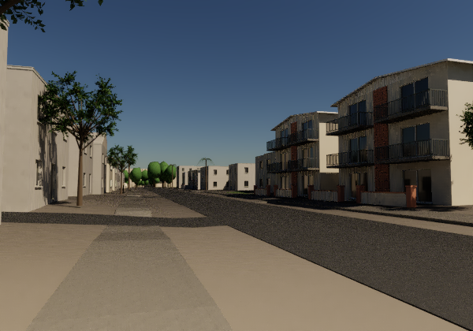
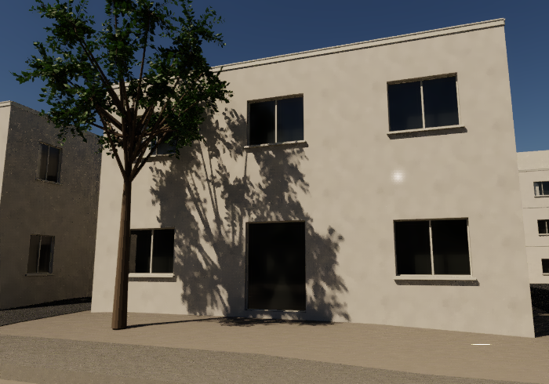

# Reusable Isla Vista facade construction, candidate v2

This separate candidate operates on the existing mapped whole-region source. It does not overwrite the merged original facade builder or the accepted Sabado profile. It uses original CYBR native geometry and retained optical fields; no photograph is a texture.

## Source and authored detail

- The 986 active generic buildings and 998 replaced wall components remain the same. Source footprints, retained floor counts and roof surfaces are unchanged. Dedicated photographed properties retain their original meshes.
- Existing source class and a stable source-ID digest choose three restrained window families. Family, dimensions, frames, hidden backing, curtains, and missing frontage remain authored estimates. They are not building-by-building observations.
- Frontage selection now prefers mapped non-service through-streets, including unnamed streets. Each proposed opening span is tested against other mapped footprints within 0.30 m. This is a source-map heuristic, not a surveyed party-wall test.
- Opposing reveals have independently tested winding: jamb normals face into the opening, sill up, head down. Frames and sills are closed solids; glazing and backing are separated. Side curtain panels use 75 mm fold pitch and 12 mm depth.
- Roof-edge strips follow exterior/courtyard boundaries recovered from the actual serialized roof triangles. Existing roof shape, slope and upper height are retained. Shallow trim projects at most 42 mm; window sill/drip edges project at most 80 mm. These construction projections are estimates, distinct from the unchanged mapped wall footprint.
- Other nearby building footprints are checked against each full roof-edge segment before adding trim. No new gables, hips, balconies, roof equipment or source planting polygons are invented.
- Coordinates are converted to the native float32 representation before face normals are computed. This keeps the saved normals consistent with the actual exported small members.

## Geographic and visual provenance

The existing whole-region source notices remain applicable: dated OpenStreetMap data are ODbL, UCSB and other geographic inputs retain their actual stated terms, and authored geometry is distinguishable from those inputs.

Local architectural observations are recorded in references/residential-street-v2/REFERENCE_MANIFEST.json and references/del-playa-corridor/REFERENCE_MANIFEST.json. On this pass all six reference photograph downloads matched their previously recorded raw hashes. Photographs are private visual references only; their pixels are excluded from this source package. Capture dates remain unknown. Broad fascia, paired windows, deep sliders and pale/dark trim are vocabulary, not evidence for copying a particular property's details across Isla Vista.

## Verification and capture

Run work/test_iv_facade_assemblies.py for independent primitive direction, closed-box and metric-chart checks. The bounded build writes evidence/full-iv-facades-v2; work/verify_iv_facades_v2.py reads the serialized mesh and independently checks source identities, source floor counts, replacement components, native attributes, source-plan projection and retained roof-height limits. The complete building system is not represented as a watertight interior solid.

The matched capture uses the accepted 600 x 420 Sabado profile camera with identical light, materials and exposure. Only the generic facade mesh changes. Generic exclusions are rebuilt by source identity, because new per-material groups do not retain the original object numbering. The capture records every active mesh hash and excluded dedicated source.

The original native scene's broad bare ground, paving appearance, sparse source-supported landscaping and incomplete street furnishings remain separate limitations. This candidate does not silently add other regional roof/landcover stages that were absent from the matched camera's baseline.

## Public replay

After the existing complete source replay, path-chart repair, original Sabado frontage capture, and accepted Sabado profile build/render described in SABADO_PROFILE.md:

```sh
./run.sh facades-v2 build
./run.sh facades-v2 render --spp 32
```

Each build/check/render stage uses the shared lock, CPUs 0 and 1, a 900-second limit, sampled 4,480 MiB process-tree RSS cap and 1 GiB disk reserve. The commands use run.sh's explicit supported AVX2/Haswell profile. Do not treat a prior receipt as proof that a cache remains valid. The build proof below was obtained from the retained local closure; a new complete 64-stage public rebuild was not repeated for this optional patch.

The workflow runs the tiny independent member geometry/chart regression and retains all existing source-fetch/base-rebuild checks. It does not run the full optional 986-building facade rebuild or its large render.

## Actual native evidence



The [compact proof](proof/FACADE_V2_NATIVE_GATE.json) records the 3,720,462-triangle facade mesh, source identity/envelope checks and native 11,753,129-primitive frame. The render used 209 seconds total and 2,990 MiB sampled peak. At this wide 600px view the change is modest; this is a reusable construction correction, not evidence that the entire street now appears photographic.


## Source-anchored close street view

```sh
./run.sh facades-v2 close
```



The camera targets [OpenStreetMap way 42753147](https://www.openstreetmap.org/way/42753147), whose retained tags identify 6538 Sabado Tarde Road and two floors. It stands outside every mapped building, near mapped Sabado Tarde Road. Eye height, framing, generic window layout and all construction dimensions are authored. This is not a photographic reconstruction or survey of that property.

At 700×490 and 32 packets the closed members, insets, sill projections and roof-edge strip are visible. The bounded run took 334 seconds and 3,178 MiB sampled peak, with zero invalid paths. Two bright high-variance samples remain; there is no radiance clamp. The proof records their raw-film values and uncertainty. Original raw buffers are retained locally, not duplicated in the public source package.
