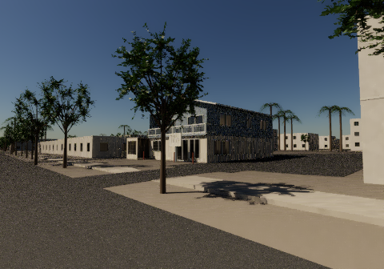
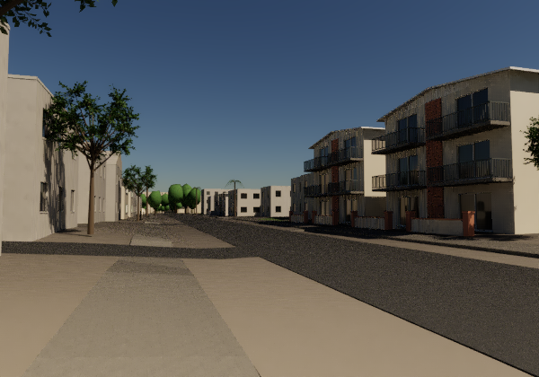
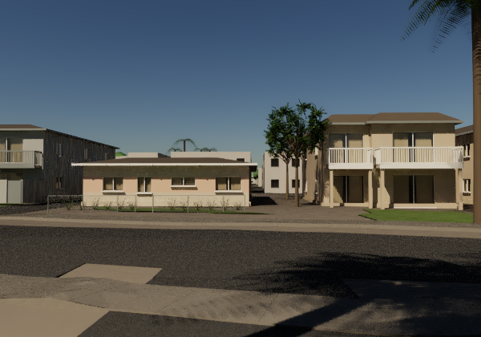

# Whole-region Isla Vista recovery

This restores the original mapped residential, street and coastal authoring
pipeline alongside the bounded lagoon checkpoint in the parent directory.
It is **coverage recovery**, not a claim that the old scene is newly
photorealistic. The first recovered street views are quality gates. Generic
buildings, vegetation and surface appearance still have visible limitations.

The geographic base includes 2,103 mapped buildings: 1,698 OpenStreetMap
buildings and 405 UCSB buildings. Individually reference-authored assemblies
cover the retained 6503 house, Pardall Center, three Del Playa properties and
the Sabado Tarde group. Footprints, source tags and mapped roots remain
distinguishable from estimated façades, dimensions, species forms and optics.

## Reproduction

Use Linux x86-64 with AVX2 and FMA, Python 3.12, a C++17 compiler, and
sufficient disk space for the generated scene. No private Library item or GitHub credential is needed.

```sh
./run.sh setup
./run.sh fetch
# The complete later coastal/canopy chain also needs these dated public inputs:
./run.sh coastal
./run.sh build 1 64
./run.sh repair-path-uv
./run.sh frontage sabado
./run.sh frontage del-playa
```

All build/render phases use two CPU threads, CPU affinity 0/1, a sampled
4,480 MiB owned-process-tree RSS guard, a 900-second stage deadline and a
1 GiB free-disk reserve. This is a sampled user-space guard, not a kernel
hard memory limit. Set `CYBR_HEAVY_LOCK` to the same absolute lock file used
by other concurrently running CYBR landscape tasks. The 64 steps are listed
with `python tools/recover_whole_iv_stages.py --list`. Existing stage receipts
are never treated as an automatic cache-validity proof: use a fresh tree for
a complete replay, or explicitly select the next unexecuted stage range.

The renderer is the byte-verified `cybrlight.scene_compat` namespace snapshot
already published at `../vendor/light-scene-compat`. Its canonical ownership
remains LIGHT commit `ef2b14ec4e815db00509098cbdc48b2363d312b7`; canonical LIGHT
is private. No newer LIGHT engine files or unrelated history are bundled here.

Ten required GEO/TERRAIN files are fetched from public commit
`c44aa00d50c38b7898fb63ac9e93959290b12445`, matching the original dependency
bytes. MATERIAL construction is fetched from public commit
`12848c82f60bc58fa88640545868009b90298b32`. No alternate soil/asphalt recipe
is introduced. Scene-specific optical adaptations remain explicit estimates.

## Exact CPU-dispatch profile

`run.sh` sets `OPENBLAS_CORETYPE=Haswell` and disables all NumPy AVX512
kernels before Python imports NumPy. `tools/check_replay_cpu_profile.py`
checks Linux x86-64, hardware AVX2/FMA, active NumPy dispatch and the actual
bundled OpenBLAS core. It fails clearly on unsupported hosts. This is an
explicit supported replay profile, not a claim of bitwise identity on ARM
or every processor/library build. The direct multi-stage build inherits it.

The original unpinned AVX512/SkylakeX baseline remains unchanged in
`proof/FRESH_PUBLIC_BASE_REPLAY.json` and `proof/BASE_DECODED_SEMANTICS.json`.
The profile-specific exact baseline is `proof/BASE_AVX2_DECODED_SEMANTICS.json`.
CI checks both raw bytes and every decoded accessor/image/binding against
the latter; no numerical tolerance has replaced these checks.

`proof/QUALIFIED_AVX2_REPLAY_COMPARISON.json` records why this profile was
introduced. An independent bounded rebuild reproduced the formerly failing
CI GLB byte-for-byte. Only four near-zero terrain coordinates (at most
4.46e-14 m), four UV values (3.57e-14), 385 near-zero bark normal components
(5.94e-17) and six 8-bit albedo channel values (one level each) differ from
the original dispatch. Six roof triangles are reordered/cyclically rotated
within five tagged-roof parts: winding-preserving per-corner geometry, UV,
normal and color payloads are exactly equal. Part layout, IDs, bindings,
all remaining decoded values and terrain state remain exact. No geographic
source, authored physical parameter or export precision was changed.

The full 64-stage chain has not been freshly rerun under this new profile;
its fresh CI qualification is stage 1. Earlier coverage renders retain
their original runtime/dispatch provenance.

## Inputs and access limits

`snapshots/osm/` holds nine exact dated ODbL snapshots. `whole_inputs.py`
decompresses and hash-checks them. The original OSM IDs, versions, timestamps
and attributes remain intact. See `THIRD_PARTY_NOTICES.md`.

UCSB GIS and USGS exported DEM inputs are fetched from the recorded public
URLs. A raw hash match passes. For ArcGIS feature pages, a separately pinned
canonical contract also accepts differences confined to unconsumed service
schema or JSON formatting: every ordered feature, attribute, coordinate and
CRS must still match. Meaningful changes fail clearly. A live query URL is
not a durable archive; if it changes, an accessible compatible dated snapshot
is required. No silent refresh to current geography occurs.

The coastal command fetches the dated 2016 CDFW archive, the CAL FIRE 2022
county classification archive and a bounded original NOAA/USGS CoNED raster
window. Archive hashes and extracted geometry/grid/band contracts are pinned.
The classifications are dated geographic evidence, not a present-day tree or
kelp inventory. The exact native classification/elevation grid is preserved.
These downloads are deliberately separate from basic street source setup.

`evidence/coherent-daylight/native_sky.pfm` is one required authored radiance
input, not a final scene image. The original Blender Nishita export and native
spectral-fit sources and receipts accompany it. It avoids forcing a much
larger Blender dependency solely to recreate the input sky. It is not measured
local weather. No reference photograph is packaged or used as a texture.

## Precision repair and visual limits

Applying the retained metric concrete finish to old path contacts exposed
float32 UV collapse on tiny triangles. `rebase_recovered_path_uv.py` translates
each path chart by whole 0.32 m texture periods before float32 serialization.
Top faces retain world-XY mapping; construction edges use the original
physical arclength/height mapping, selected by the source object classification.
All 2,383,698 contact triangles retain positions, normals, tint, material and
object IDs, and order byte-for-byte. The unchanged serialized metric-chart
preflight remains mandatory before the focused frontage captures.

Those frontage captures are an early complete-geography assembly with the
retained individual buildings, metric paths and whole detailed street trees.
The later full coastal/regional-canopy scene is a separate retained assembly.
They do not establish photographic accuracy or a completed realism leap.
Generated CLMs, repeated historical render caches and unrelated experiments
are excluded from this source package.

## Inspected native recovery views

These are actual original CYBR LIGHT CPU captures. They restore street coverage
and authored façade detail; coarse road grain, plain surfacing and shallow-looking
window/edge construction remain visible. No new photorealism claim is made.


Pardall Center, early geographic/architectural recovery, 480 × 336 / 16 samples.


Sabado Tarde retained frontages and mapped street trees, 600 × 420 / 32 samples.


Del Playa retained individually referenced frontages, 600 × 420 / 32 samples.

Mapped geography © [OpenStreetMap contributors](https://www.openstreetmap.org/copyright);
UCSB GIS and other source-specific credits are in `THIRD_PARTY_NOTICES.md`.
The original authored façade dimensions, materials, species forms and viewpoints
are estimates. Native capture receipts sit beside each image.

`proof/FRESH_PUBLIC_BASE_REPLAY.json` records an independent public-source
base build whose GLB, terrain state, normalized geography, part layout and
tagged-roof outputs are byte-identical to the recovered source. This check
does not claim a second fresh replay of every later stage.

## Authored Sabado sidewalk profile

A focused subsequent construction correction preserves the source terrain and
mapped width while reducing the foreground walk crossfall and reconciling its
closed edges. See [SABADO_PROFILE.md](SABADO_PROFILE.md) for the bounded source
replay, numerical proof and explicit limits. It is separate from the original
coverage-recovery views above.
