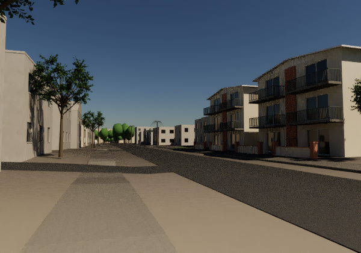

# Bounded Sabado north-sidewalk construction correction

The north-sidewalk foreground in the recovered Sabado view inherited about
10% transverse grade from the coarse terrain. The new authored construction
profile targets 2% crossfall about the mapped centerline height +0.14 m.
Underlying geographic terrain, mapped XY footprint, source IDs and the retained
**estimated** 1.8 m width remain unchanged. This is not a measured curb design
or an accessibility qualification.

## Replay

First complete the main README's full source replay, chart repair and original
Sabado frontage capture. Those provide the contact mesh and matched baseline
scene. Then, using the same supported AVX2/Haswell environment and installed
reviewed runtime:

```sh
./run.sh profile-sabado build
./run.sh profile-sabado render --spp 32
# Optional higher-sample view of exactly the same camera/material/light:
./run.sh profile-sabado render --spp 128
```

Each stage takes the shared heavy lock and uses the existing two-CPU,
4,480 MiB sampled RSS, 900-second and 1 GiB disk-reserve limits. Existing
receipts are not treated as valid caches. Use a fresh replay tree rather than
silently overwriting proof of a prior run.

The geometry is bounded to OSM way 592214516 between local x490–665 m, with
10 m end blends. Its approximately 2% transverse target follows the mapped
walk normal; the nearest main road chooses outward direction only. Source
service driveways control local transitions. Grades/dimensions are explicit
authored estimates, not modifications to the geographic elevation dataset.

Independent cap and side tessellations originally disagreed by up to 25 mm.
The correction splits affected edge segments at actual serialized cap-facet
breakpoints, including edges whose own endpoints did not move but which
border changed cap triangles. Top surfaces themselves are unchanged during
that conformance step. Physical edge charts, normals, source IDs and bottom
construction lines remain checked.

## Verified scope

- Four ordinary 1.70 m interior cross-sections of the estimated 1.80 m walk: approximately 1.88–2.05% after;
  the visible foreground section was 10.293% and is 1.987% after.
- 68,040 sampled cap points clear unchanged terrain by at least 17.998 mm.
- 290 original edge segments become 861 facet-aligned segments. Refined-edge
  and all-adjacent-cap tests cover 14,637 and 14,620 samples respectively, with
  a maximum sampled gap of 1.56 micrometres and no missing support.
- Refined XY perimeter rounding is at most 30.1 micrometres; bottom-line
  interpolation error is at most 0.474 micrometres. Cap and unrelated face
  payload/order remain exact, with signed-zero equivalence only.
- The tiny synthetic two-facet fixture detects the old 100 mm straight-chord
  gap and verifies subdivision closes it without full geographic inputs.

Local short-facet slopes vary more than the 1.70 m interior target because the
original cap triangulation remains. Support/closure checks are dense bounded
samples, not a formal continuum or engineering certificate. The native visual
proof is recorded separately; successful geometry checks alone do not establish
photorealism. Materials, camera and illumination are not altered by this patch.

See the main README and THIRD_PARTY_NOTICES.md for mapped geography and dataset
attribution. This patch adds authored construction estimates; it introduces no
new source photos, texture images or geographic dependency.

## Native matched gate



Actual native CYBR LIGHT, 600 × 420 at 32 packets, 9,356,861 primitives and
zero invalid path samples. The 198.9-second bounded job peaked at 2,483 MiB.
The visible change is modest at this camera: this qualifies construction
profile/contact, not a large photorealism leap. Existing broad bare-terrain
bands and low-sample road grain remain. Geographic attribution:
© OpenStreetMap contributors; UCSB GIS and other credited datasets in the
main notices. No source-reference-photo pixels are bundled.

Compact exact hashes, measured deltas and verification limits are in
[proof/SABADO_PROFILE_NATIVE_GATE.json](proof/SABADO_PROFILE_NATIVE_GATE.json).
